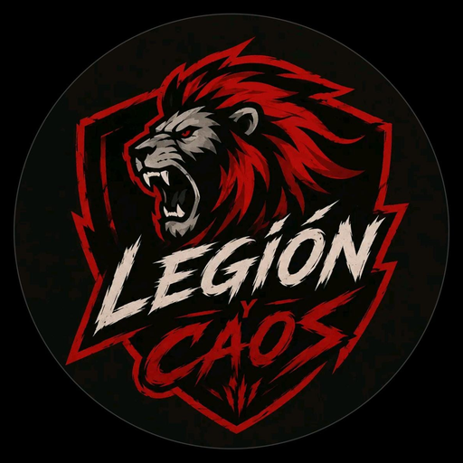

  

<h1 align="center">⚔️ LEGIÓN DEL CAOS ⚔️</h1>

<b>La app de mensajería de la Legión: chats, grupos, llamadas y guerra de clanes, todo en rojo y negro.</b>

  <a href="https://p-salcedo.github.io/legion-caos/"><b>🌐 Abrir la app</b></a> ·
  <a href="GUIA.md"><b>📘 Guía de instalación</b></a> ·
  <a href="#-funciones"><b>✨ Funciones</b></a>

---

## 🔥 ¿Qué es Legión Del Caos?

Una app de mensajería pensada para clanes, escuadras y comunidades que quieren hablar, organizarse y pelear juntos. Funciona en el navegador, se instala en tu celular como una app y también existe como APK para Android.

Entra con tu usuario, agrega a tu gente y ya estás dentro de la Legión.

## 🏆 ¿Por qué unirte?

- 💬 **Chats en tiempo real**: los mensajes llegan al instante, con ✓✓ y separadores por día.
- 🎭 **Stickers animados**: 16 stickers con movimiento, y la opción de subir tus propias imágenes.
- 🛡️ **Clan Legión Caos**: un grupo oficial donde están todos los miembros.
- 📋 **Encuestas de equipos**: organiza escuadras de 4 personas, con tiempo límite para cambiar.
- 📞 **Llamadas de voz y video**, con el tono de llamada que tú eliges.
- 🎨 **Un diseño que se siente vivo**: fondo animado, brasas flotando, brillos y transiciones suaves.
- 🆓 **Gratis**: corre sobre GitHub Pages y Supabase, sin costo.
- 📱 **Instalable**: como app en tu celular, sin pasar por una tienda.
- 🔐 **Cuentas protegidas**: contraseñas cifradas y reglas de acceso en la base de datos.

## ✨ Funciones

### 💬 Chats privados
- Busca a tus contactos por usuario o por número de teléfono.
- Ponle un **apodo** a cada persona y cambia el **fondo** de cada chat: llamas de código, lluvia de código, sangre, abismo o negro.
- Toca el nombre de la persona para ver su **información**: número, fecha de registro, info e insignias.

### 👥 Grupos y Clan
- Crea grupos **Solo** (abiertos, tú decides quién entra) o de **rango**: Creadores, Moderadores, Patrocinador, Creador de contenido o Veterano. Los de rango se llenan solos con quien tiene esa insignia.
- **Clan Legión Caos**: todos los usuarios están dentro, los nuevos y los antiguos. Solo moderadores y creadores lo administran.
- Los administradores deciden quién puede mandar mensajes, quién puede editar el nombre y quién puede cambiar la foto.
- Toca el nombre del grupo para ver sus miembros y su configuración.

### 📋 Encuestas de equipos
- Los moderadores publican una encuesta con título, texto y equipos.
- Cada equipo tiene 4 cupos. Te unes tocando el equipo que quieres.
- Tienes **5 minutos** para cambiar de equipo. Después, tu elección queda fija.
- Los moderadores pueden mover, agregar o quitar personas, y cerrar o reabrir la encuesta.

### 📞 Llamadas
- Voz y video entre usuarios, con micrófono y silencio.
- Cada persona elige su **tono de llamada**: Clásico, Campana, Caos o Trueno.
- Funcionan mientras la app esté abierta.

### ⭕ Estados
- Publica un estado de texto que se oculta automáticamente a las **24 horas**.

### 🛡️ Insignias y moderación

| Insignia | Qué significa |
|---|---|
| 👑 **Creador** | Dirige la Legión: mantenimiento, rangos y moderación |
| 🛡️ **Moderación** | Administra usuarios, grupos y encuestas |
| 🎬 **Creador de contenido** | Reconocimiento a quienes crean contenido |
| 💎 **Patrocinador** | Reconocimiento a quienes apoyan la Legión |
| 💞 **Parejas** | Para quienes van en pareja |
| 🎖️ **Veterano** | Para los miembros con más historia |

- El panel 🛡️ **Moderar** muestra a todos los usuarios en una lista. Tocas a uno y le asignas o le quitas insignias.
- Los moderadores pueden sancionar a un usuario. El creador puede activar el **modo mantenimiento** con un mensaje personalizado para todos los demás.

### 🎨 Diseño
- Tema rojo y negro, con un fondo que se mueve despacio y brasas que flotan.
- Paneles de cristal, brillos en el Clan y transiciones suaves entre pantallas.

### 🔐 Seguridad y privacidad
- Las contraseñas se guardan **cifradas** en Supabase Auth. Nadie, ni el administrador, puede leerlas.
- Cada usuario solo ve lo que le corresponde: las reglas de la base de datos lo garantizan.
- Transparencia: el administrador del proyecto puede ver los mensajes desde el panel de Supabase. La app **no** tiene cifrado de extremo a extremo.

## 🧩 ¿Qué contiene el proyecto?

| Archivo | Para qué sirve |
|---|---|
| `index.html`, `styles.css` | Pantallas y diseño |
| `app.js`, `ui.js`, `calls.js` | Lógica: cuentas, chats, grupos, encuestas y llamadas |
| `config.js` | Datos de conexión con tu base de datos |
| `sw.js`, `manifest.webmanifest` | Instalación como app y uso básico sin conexión |
| `icon-*.png`, `apple-touch-icon.png` | Íconos de la app |
| `supabase*.sql` | Base de datos, reglas de seguridad y funciones (se ejecutan en orden) |
| `.github/workflows/main.yml` | Genera el APK de Android |
| `GUIA.md` | Paso a paso para instalar y configurar todo gratis |

## 🚀 Empieza ahora

1. **Abre la app** en tu navegador: [p-salcedo.github.io/legion-caos](https://p-salcedo.github.io/legion-caos/)
2. **Instálala** en tu celular:
   - Android (Chrome): menú ⋮ → *Instalar aplicación*.
   - iPhone (Safari): botón Compartir → *Agregar a pantalla de inicio*.
3. **Descarga el APK** de Android desde la pestaña *Actions* del repositorio, ejecutando el flujo *Generar APK*.
4. **Crea tu cuenta** con un usuario único y una contraseña de al menos 6 caracteres.

## 🛣️ Próximamente
- 🔔 Notificaciones push, para no perderte una llamada o un mensaje.
- 💬 Chat propio para cada escuadra.
- 🌍 Llamadas que funcionen con datos móviles (servidor TURN).
- 📸 Fotos completas en el chat.
- 🏪 APK firmado para subirlo a Google Play.

## 🤝 Únete a la Legión
¿Tienes una idea o encontraste un error? Abre un *Issue* en este repositorio.
Comparte el link con tu clan y pon tu usuario en el Clan Legión Caos.

## 🧱 Tecnologías
HTML, CSS y JavaScript · Supabase (autenticación, base de datos y tiempo real) · WebRTC para las llamadas · Service Worker (PWA) · Capacitor y GitHub Actions para el APK · GitHub Pages para publicar.

## 📄 Licencia
© 2026 Legión Del Caos. Todos los derechos reservados.
El código es público para que lo veas y aprendas de él, pero no puede copiarse ni redistribuirse como si fuera tuyo sin permiso.

---

<b>⚔️ Hasta la victoria, Legión ⚔️</b>

